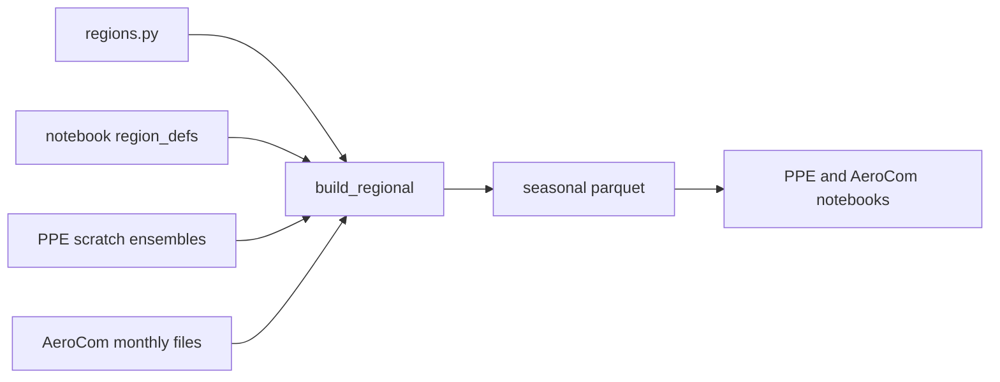

# AeroCom and PPE error attribution

Analysis of AeroCom Phase III (2010) and the Pace ECHAM-HAM perturbed-parameter ensembles (2010 and Aug 2024–Jul 2025). The project compares regional aerosol optical depth, absorption, lifetime and mass extinction or absorption against SPEXone, POLDER-GRASP and GPCP.

Region geometry and the land/sea mask live in one place: [`py/regions.py`](py/regions.py). Each box has `surface_type` (`land`, `ocean` or `all`). A notebook can pass a different `region_defs` dict into `build_regional` and recompute without editing that file.

## Data flow

| Step | Where |
| --- | --- |
| PPE source files | Read-only ensembles. Monthly 2-D extracts go to `/scratch-shared/jzhang1/PPE/<ppe_id>/`. |
| AeroCom source files | `Data/AP3_processed_monthly/` |
| Build | `python py/regional_aggregates.py --source ppe` or `--source aerocom` |
| PPE tables | `Data/PPE_regional/ppe_regional_{monthly,seasonal}.parquet` |
| AeroCom wide table | `tables/aerocom_regional_seasonal.parquet` |
| Legacy long AeroCom table | `python py/build_regional_aggregates.py --legacy` |
| Notebooks | `notebooks/AOD_SS_ERROR_PPE.py`, `AAOD_error_attribution_PPE.py`, `AOD_DUST_ERROR_PPE.py`, and the AeroCom attribution scripts |

`py/ppe_regional_aggregates.py` re-exports `regional_aggregates`. Quality filter `"ppe"` (AOD > 0.01) is the default. Pass `quality="aerocom"` for the stricter AOD > 0.05 filter.

Lifetimes are burden divided by emission after the regional mean. Sea salt plus sulfate uses primary sea salt and sulfate plus half of the SO2 and DMS emissions, converted to sulfate mass (`ppe_io.add_lifetime_drivers`). The PPE extract has no deposition fluxes. AeroCom deposition lifetimes are drawn only when those columns exist.

## Maps

Boxed regional maps use `cameo_toolbox.fake_uba_map` through `plot_boxed_field` (Plate Carrée, so the rectangles stay straight). Maps with no analysis box use `uba_map_flex(..., projection_type="curved")` through `plot_curved_field`.

## Notebook efficiency

The older attribution scripts used to reopen every model file and repeat time handling, masks and regional means in each file. Those helpers now call `aerocom_data`, `notebook_setup.aggregate_region` and `ppe_io`. The PPE notebooks read the parquet and only plot. An older notebook can do the same: call `build_regional` once, then keep its attribution algebra.
