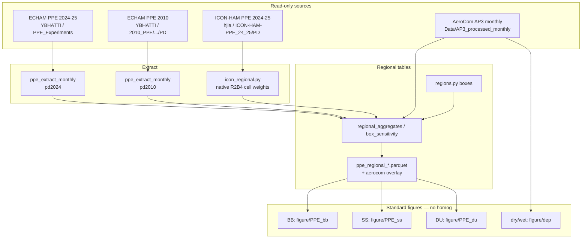

# AeroCom and PPE error attribution

Analysis of AeroCom Phase III (2010) and the Pace ECHAM-HAM perturbed-parameter ensembles (2010 and Aug 2024–Jul 2025). The project compares regional aerosol optical depth, absorption, lifetime and mass extinction or absorption against SPEXone, POLDER-GRASP and GPCP.

Region geometry and the land/sea mask live in one place: [`py/regions.py`](py/regions.py). Each box has `surface_type` (`land`, `ocean` or `all`). A notebook can pass a different `region_defs` dict into `build_regional` and recompute without editing that file.

## Data flow

Three PPEs plus AeroCom feed the same regional tables and BB / SS / DU notebooks.
Figure inventory by aerosol type: [`docs/FIGURE_MATRIX_BB_SS_DU.md`](docs/FIGURE_MATRIX_BB_SS_DU.md).



| Ensemble | `ppe_id` | Root | In plots today |
| --- | --- | --- | --- |
| ECHAM-HAM 2024-25 (YBHATTI) | `pd2024` | `…/Pace_PPE_Output/PPE_Experiments` | yes |
| ECHAM-HAM 2010 (YBHATTI) | `pd2010` | `…/2010_PPE/Collaboration/Processing/PD` | yes |
| ICON-HAM 2024-25 (hjia) | `icon2025` | `…/ICON-HAM-PPE_24_25/PD` | yes (native-grid regional means) |
| AeroCom AP3 | — | `Data/AP3_processed_monthly/` | diamonds on combined panels |

| Step | Where |
| --- | --- |
| PPE source files | Read-only ensembles above. Monthly 2-D extracts → `/scratch-shared/jzhang1/PPE/<ppe_id>/`. |
| AeroCom source files | `Data/AP3_processed_monthly/` |
| Build | `python py/ppe_regional_aggregates.py` (ECHAM); `python py/icon_regional.py` (ICON-HAM); AeroCom overlay via `python py/box_sensitivity.py` |
| PPE tables | `Data/PPE_regional/ppe_regional_{monthly,seasonal}.parquet` |
| AeroCom wide table | `tables/aerocom_regional_seasonal.parquet` |
| Legacy long AeroCom table | `python py/build_regional_aggregates.py --legacy` |
| Notebooks | `notebooks/AOD_SS_ERROR_PPE.py`, `AAOD_error_attribution_PPE.py`, `AOD_DUST_ERROR_PPE.py`, and the AeroCom attribution scripts |
| Figure matrix | [`docs/FIGURE_MATRIX_BB_SS_DU.md`](docs/FIGURE_MATRIX_BB_SS_DU.md) |

`py/ppe_regional_aggregates.py` re-exports `regional_aggregates`. Quality filter `"ppe"` (AOD > 0.01) is the default. Pass `quality="aerocom"` for the stricter AOD > 0.05 filter.

Lifetimes are burden divided by emission after the regional mean. Sea salt plus sulfate uses primary sea salt and sulfate plus half of the SO2 and DMS emissions, converted to sulfate mass (`ppe_io.add_lifetime_drivers`). The PPE extract has no deposition fluxes. AeroCom deposition lifetimes are drawn only when those columns exist.

## Maps

Boxed regional maps use `cameo_toolbox.fake_uba_map` through `plot_boxed_field` (Plate Carrée, so the rectangles stay straight). Maps with no analysis box use `uba_map_flex(..., projection_type="curved")` through `plot_curved_field`.

## Dashboard

A local page draws the monthly fields and the same area-weighted regional mean as the seasonal tables. Leaflet, the draw tool, the coastline and the country borders are stored in the repo, so the page does not download a basemap.

```bash
cd /home/jzhang1/AeroCom_Error
PYTHONPATH=py:. .venv-1/bin/python -m uvicorn dashboard.app:app --host 127.0.0.1 --port 8765
```

From a laptop, `ssh -L 8765:127.0.0.1:8765 <user>@<host>` and open `http://127.0.0.1:8765`.

| Control | What it does |
| --- | --- |
| Dataset | `pd2024`, `pd2010`, ICON-HAM 2024–25 (hjia, `icon2025`), one AeroCom model, SPEXone, or POLDER-GRASP 2010 |
| Months | Annual mean (every month in that dataset) or any subset, averaged together |
| Member | Ensemble mean, or one PPE member. ICON ensemble mean reads every native-grid member the first time |
| Land / sea border | Coastline, on by default |
| Country borders | Optional |
| Region boxes | Dropdown adds one `py/regions.py` box at a time |
| Drawn polygon | Area-weighted mean with the land/sea mask. ICON uses native R2B4 cell areas; the picture is a 1° bin |
| Pipeline paths | Overlay of data-flow boxes; hover shows the absolute path, click copies it |
| Click map | Latitude, longitude and cell value for the loaded field (field image repeats at lon ±360) |
| Go to aggregate plots | Opens `/plots` with the boxes on the map. Monthly parquet tables, month choice, MAC/MEC/lifetime spreads, marine/total species, save PNG under `figure/dashboard/` |

SPEXone offers **regridded** (resolution in the filename, e.g. `…_0.5deg_v4_0.parquet`; legacy files without a token are 1°) or **native overpass** from `Data/SPEXone/Extract*L2*`. **Submit SPEXone regrid (SLURM)** runs `dashboard/spex_regrid.sbatch` for 0.1 / 0.5 / 1°. POLDER is the 2010 collocation file, reduced to 1° with the same quality filter as the notebooks. The first request builds `dashboard/cache/`.

A saved polygon has an annual cycle: for each month, the area-weighted spatial mean and the spatial standard deviation inside the box (y-axis labelled). **Annual cycle** uses the dataset and variable currently selected.

**Aggregate on this node** or **Submit SLURM job (32 GB)** runs the full regional aggregate (netCDF4 field reads into `regional_columns`, plus ICON one file at a time) and writes Polars parquet (`{slug}_monthly.parquet` and `{slug}_seasonal.parquet`). The status block shows lon/lat and those paths. The SLURM script is `dashboard/aggregate_box.sbatch`.

| What | Peak memory | What to reserve |
| --- | --- | --- |
| Dashboard, maps, one-variable annual cycle | about 2 GB | 8 GB is enough |
| One ECHAM drawn box, all variables, 8 members at a time | about 4–8 GB | |
| ICON drawn box, one native file at a time | about 2–4 GB | |
| pd2024 + pd2010 + ICON together | about 8 GB, with 5 GB of pd2024 NetCDF on disk | **32 GB** |
| Same job plus a notebook | | **64 GB** |

When the SLURM job finishes, open **Go to aggregate plots**. The drawn name is passed through and the scatter uses the new monthly table.

## Notebook efficiency

The older attribution scripts used to reopen every model file and repeat time handling, masks and regional means in each file. Those helpers now call `aerocom_data`, `notebook_setup.aggregate_region` and `ppe_io`. The PPE notebooks read the parquet and only plot. An older notebook can do the same: call `build_regional` once, then keep its attribution algebra.
